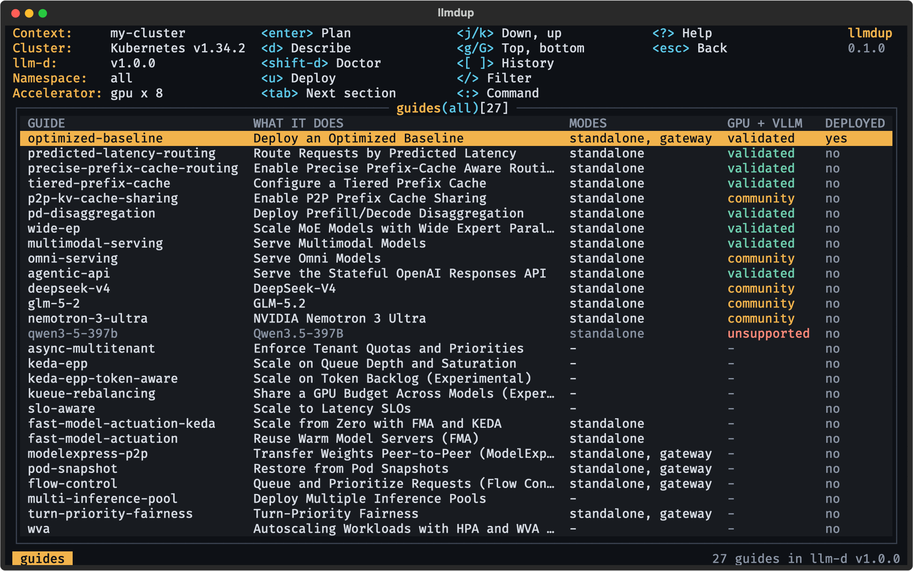
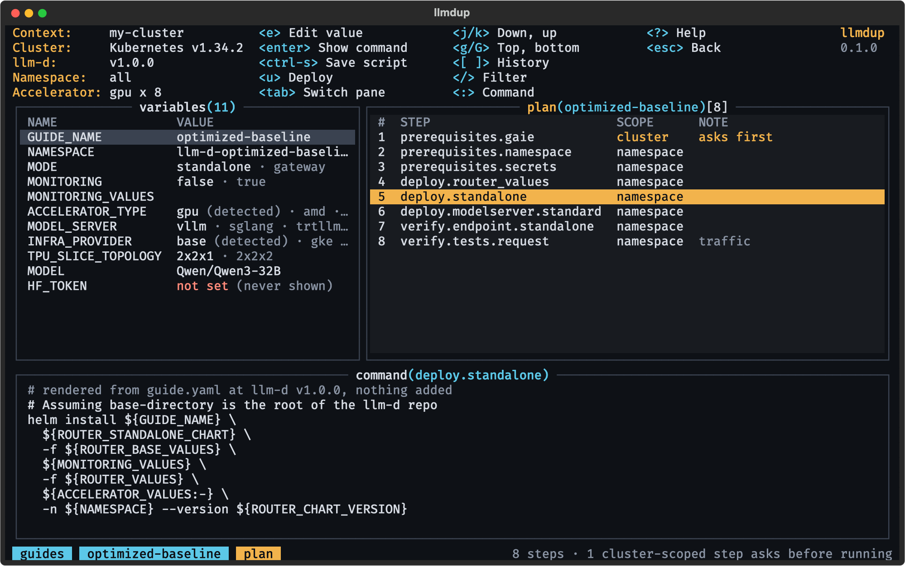
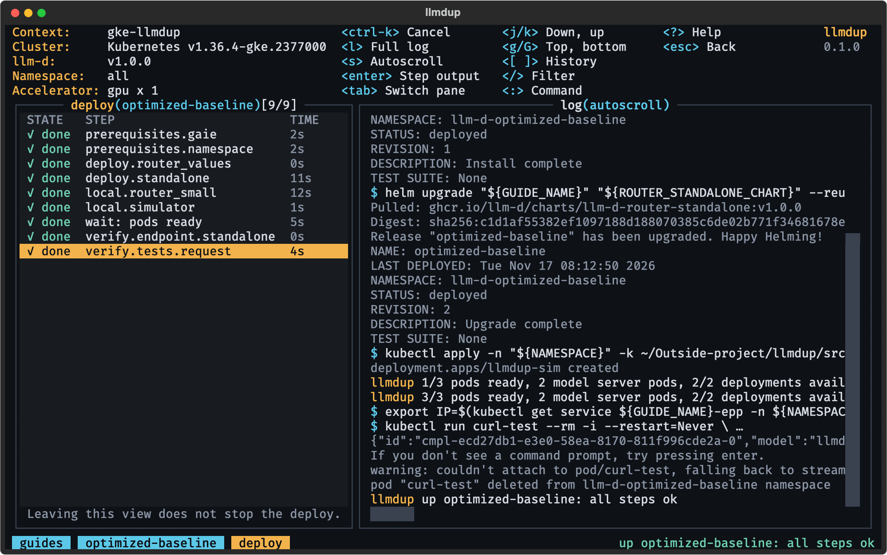
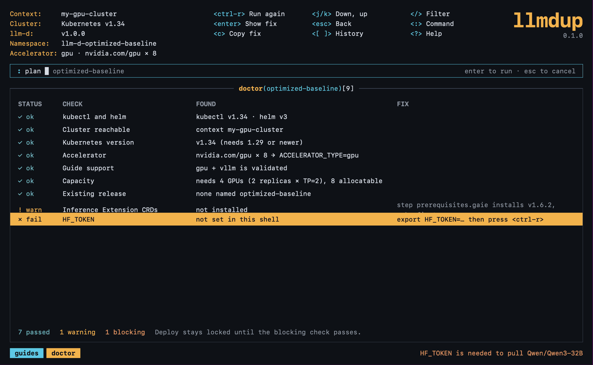
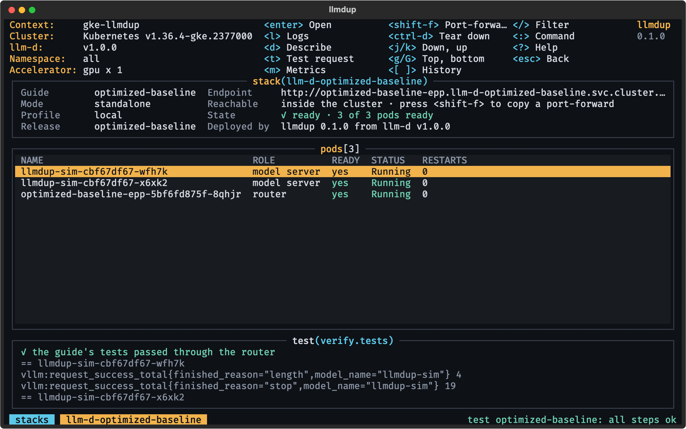
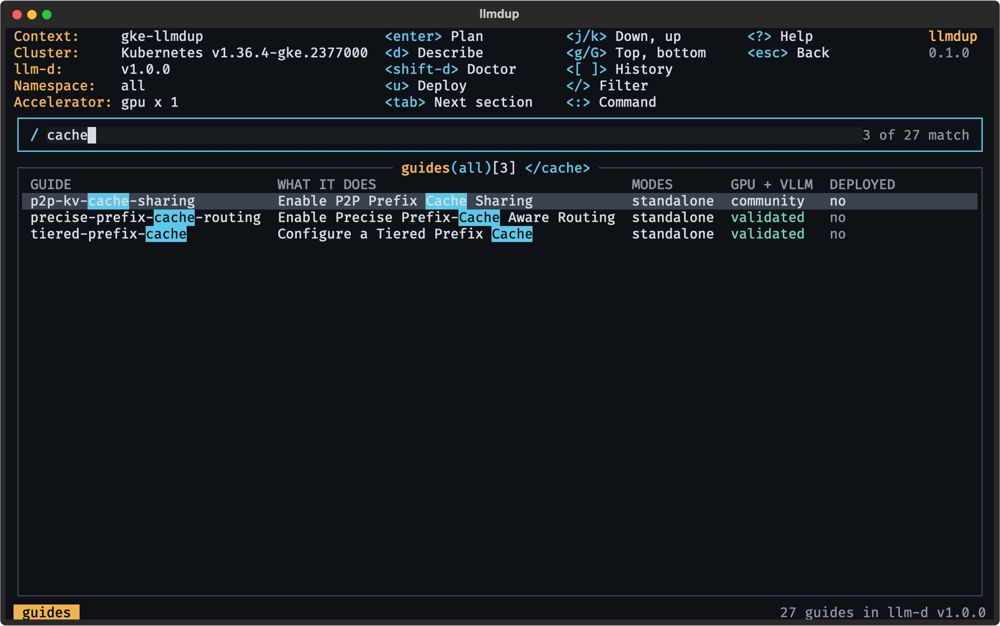
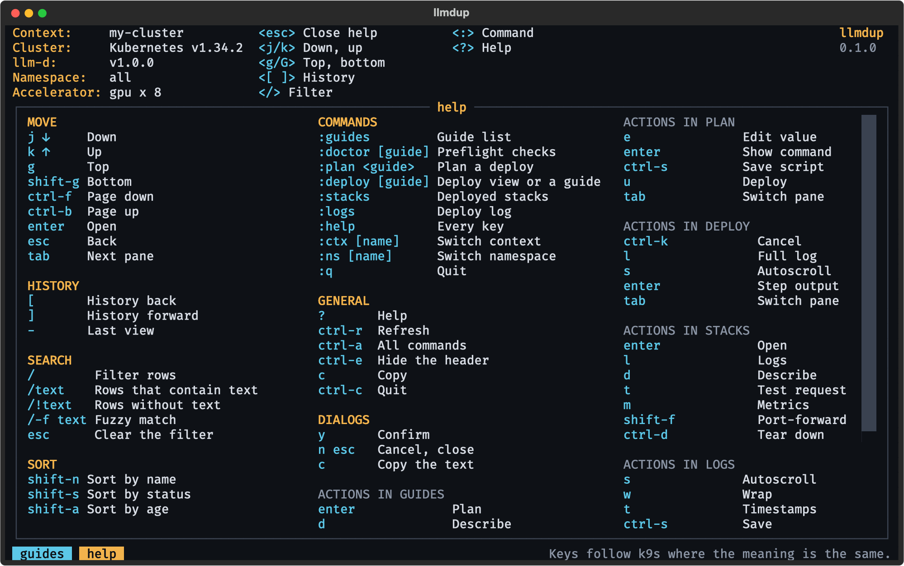
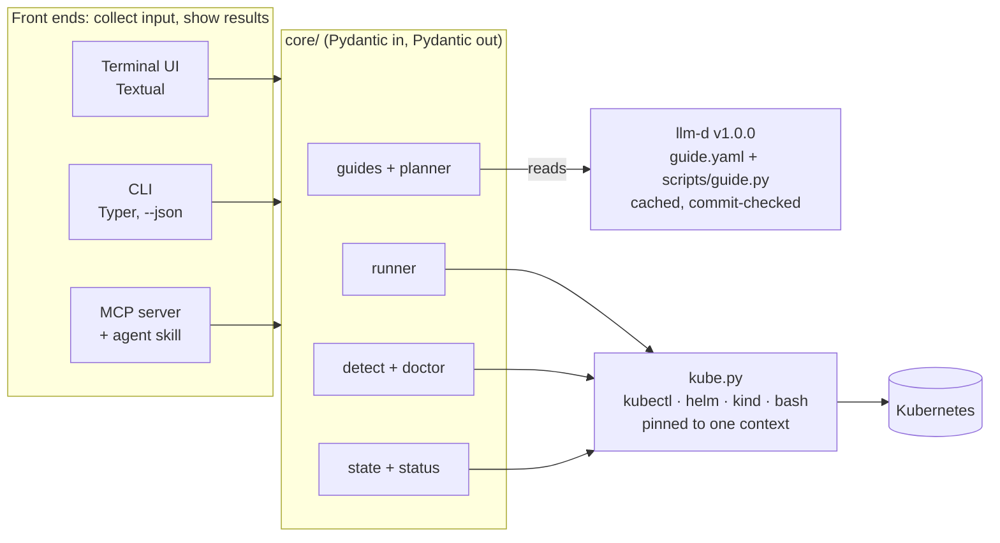

<div align="center">

# llmdup

**From a Kubernetes cluster to a working [llm-d](https://github.com/llm-d/llm-d) endpoint, in one command.**

A k9s-style terminal UI for people. A JSON CLI and an MCP server for scripts and agents.
One core, three front ends, zero copied manifests.


<br>



</div>

```console
$ llmdup local up --yes
==> [2/9] prerequisites.gaie
    customresourcedefinition.apiextensions.k8s.io/inferencepools.inference.networking.k8s.io created
==> [5/9] deploy.standalone
==> [6/9] local.router_small
==> [7/9] local.simulator
    deployment.apps/llmdup-sim created
... 0/3 pods ready, 2 model server pods, 0/2 deployments available
... 3/3 pods ready, 2 model server pods, 2/2 deployments available
==> [9/9] verify.tests.request
    {"id":"cmpl-02a38584-…","model":"llmdup-sim","object":"text_completion","choices":[{"text":"I am fine, how are you today? …"}]}
ok: up optimized-baseline: all steps ok
```

That is a real run: the llm-d router, the Gateway API Inference Extension and two simulated model servers on a laptop kind cluster, answering `/v1/completions` through the router. No GPU, about two minutes.

---

## Why llmdup

llm-d 1.0 ships every well-lit path as a machine-readable recipe: a `guide.yaml` with variables, a support matrix and ordered `prerequisites`, `deploy`, `verify` and `cleanup` steps, rendered by the release's own `scripts/guide.py`. llmdup **drives that recipe**. It writes no install commands of its own.

| | By hand from the README | llmdup |
| --- | --- | --- |
| Get the guides | `git clone`, check out the release branch | Downloads the pinned tag once, verifies its commit, caches it |
| Pick variables | Read the support table, export a dozen variables | Detects accelerator, provider and model; validates every value against the guide |
| Run the steps | Copy blocks, skip the ones that do not apply | Plans exactly the steps for your mode and choices, in guide order |
| Cluster-wide changes | Easy to miss | Flagged, shown with the real values, run only after you confirm |
| Know it worked | Watch pods, craft a curl | Waits for ready pods, sends the guide's own smoke test |
| Tear down | Find the cleanup block, hope it is complete | Runs the guide's cleanup, then checks nothing is left |
| Automate it | Parse prose | One JSON document per command, stable exit codes, an MCP server |

## Install

```bash
uv tool install llmdup        # 0.1.0 is not on PyPI yet; from a checkout: uv tool install .
llmdup version
```

Needs Python 3.14 or newer (uv installs it for you), `kubectl` and `helm`. For the local demo, also `kind` with Docker or Podman.

## Try it without a GPU

```bash
llmdup local up --yes         # kind cluster "llmdup" + optimized-baseline + llm-d-inference-sim
llmdup status                 # router and simulator pods, endpoint, how to reach it
llmdup test                   # run the guide's verify tests again
llmdup down --yes             # the guide's cleanup, then a check that nothing is left
llmdup local down --yes       # delete the kind cluster
```

The local profile is the `optimized-baseline` plan in standalone mode with three changes: the model servers become two [llm-d-inference-sim](https://github.com/llm-d/llm-d-inference-sim) replicas, the router is shrunk to fit a laptop, and the Hugging Face secret is skipped because the simulator downloads nothing. With Podman, set `KIND_EXPERIMENTAL_PROVIDER=podman`.

## Deploy on your cluster

Preflight first. Example on a GKE node pool with eight NVIDIA GPUs:

```console
$ llmdup doctor optimized-baseline --context my-cluster
[ok  ] Tools: kubectl and helm found
[ok  ] Cluster reachable: context my-cluster answers
[ok  ] Kubernetes version: v1.34.2-gke.1100000
[ok  ] Accelerators: gpu: 8 x nvidia.com/gpu
[warn] Inference Extension CRDs: inferencepools.inference.networking.k8s.io not installed
       fix: the plan installs them in its cluster-scoped prerequisites step, after confirmation
[ok  ] Guide support: gpu + vllm: validated
[ok  ] Capacity: 4 nvidia.com/gpu of 8
[ok  ] HF_TOKEN: set
[ok  ] Existing release: no release optimized-baseline in llm-d-optimized-baseline
[ok  ] Existing stack: no llmdup stack in llm-d-optimized-baseline
[skip] Gateway provider: mode standalone
```

```console
$ llmdup plan optimized-baseline --accelerator gpu
plan: up optimized-baseline  namespace llm-d-optimized-baseline  mode standalone  llm-d v1.0.0

#  STEP                         TAGS
1  prerequisites.gaie           cluster-scoped
2  prerequisites.namespace
3  prerequisites.secrets
4  deploy.router_values
5  deploy.standalone            mode
6  deploy.modelserver.standard  manual option
7  verify.endpoint.standalone   mode
8  verify.tests.request         sends traffic

needs confirmation: prerequisites.gaie
```

```bash
llmdup up optimized-baseline --context my-cluster --dry-run   # the exact script, nothing runs
llmdup up optimized-baseline --context my-cluster --yes       # doctor, deploy, wait, smoke test
llmdup status --context my-cluster
llmdup down --context my-cluster --namespace llm-d-optimized-baseline --yes
```

Choices you leave out come from detection first, then from the guide's defaults: the accelerator from allocatable resources and DRA DeviceClasses, `INFRA_PROVIDER=gke` on GKE node pools, `MODEL` from the support matrix. A value the guide does not allow exits with code 2 and lists the allowed ones. `--mode gateway` and every accelerator and engine pair in a guide's matrix go through the same path.

## Every guide in llm-d v1.0.0

All 27 guides with a `guide.yaml` load and plan for `up`, `test` and `down`, checked against the real v1.0.0 release by the network test suite:

<details>
<summary><code>llmdup guides list</code></summary>

```text
GUIDE                         SECTION             WHAT IT DOES                                     MODES               SUPPORT
agentic-api                   foundations         Serve the Stateful OpenAI Responses API          standalone          gpu+vllm: validated
multimodal-serving            foundations         Serve Multimodal Models                          standalone          gpu+vllm: validated
omni-serving                  foundations         Serve Omni Models                                standalone          gpu+vllmomni: community
optimized-baseline            foundations         Deploy an Optimized Baseline                     standalone,gateway  gpu+vllm: validated
p2p-kv-cache-sharing          foundations         Enable P2P Prefix Cache Sharing                  standalone          gpu+vllm: community
pd-disaggregation             foundations         Deploy Prefill/Decode Disaggregation             standalone          gpu+vllm: validated
precise-prefix-cache-routing  foundations         Enable Precise Prefix-Cache Aware Routing        standalone          gpu+vllm: validated
predicted-latency-routing     foundations         Route Requests by Predicted Latency              standalone          gpu+vllm: validated
tiered-prefix-cache           foundations         Configure a Tiered Prefix Cache                  standalone          gpu+vllm: validated
wide-ep                       foundations         Scale MoE Models with Wide Expert Parallelism    standalone          gpu+vllm: validated
deepseek-v4                   models              DeepSeek-V4                                      standalone          gpu+vllm: community
glm-5-2                       models              GLM-5.2                                          standalone          gpu+vllm: community
nemotron-3-ultra              models              NVIDIA Nemotron 3 Ultra                          standalone          gpu+vllm: community
qwen3-5-397b                  models              Qwen3.5-397B                                     standalone          tpu+vllm: community
async-multitenant             operations          Enforce Tenant Quotas and Priorities             -                   -
keda-epp                      operations          Scale on Queue Depth and Saturation              -                   -
keda-epp-token-aware          operations          Scale on Token Backlog (Experimental)            -                   -
kueue-rebalancing             operations          Share a GPU Budget Across Models (Experimental)  -                   -
slo-aware                     operations          Scale to Latency SLOs                            -                   -
fast-model-actuation-keda     operations-startup  Scale from Zero with FMA and KEDA                standalone          -
fast-model-actuation          operations-startup  Reuse Warm Model Servers (FMA)                   standalone          -
modelexpress-p2p              operations-startup  Transfer Weights Peer-to-Peer (ModelExpress)     standalone,gateway  -
pod-snapshot                  operations-startup  Restore from Pod Snapshots                       standalone,gateway  -
flow-control                  operations-traffic  Queue and Prioritize Requests (Flow Control)     standalone,gateway  -
multi-inference-pool          operations-traffic  Deploy Multiple Inference Pools                  -                   -
turn-priority-fairness        unlisted            Turn-Priority Fairness                           standalone,gateway  -
wva                           unlisted            Autoscaling Workloads with HPA and WVA Metrics   -                   -
```

</details>

## For scripts and agents

Every subcommand runs without prompts when given `--yes`, and with `--json` prints **exactly one JSON document** on stdout. Progress and logs go to stderr.

```json
{"schema_version": 1, "ok": true, "command": "up", "data": {"...": "..."}, "errors": []}
```

| Exit code | Meaning |
| --- | --- |
| 0 | Success |
| 1 | A step failed; `data` names the step, its command and its last 40 log lines |
| 2 | Bad usage, or a value the guide does not allow; the hint lists the allowed values |
| 3 | `doctor` found a blocking check |
| 4 | Confirmation needed, but `--yes` is absent and there is no TTY |

### MCP server

```bash
claude mcp add llmdup -- llmdup mcp
```

Eight tools over stdio: `list_guides`, `show_guide`, `doctor`, `plan`, `up`, `status`, `test`, `down`. They return the same models as the CLI's `data`. `up` and `down` are two-step by design: without `confirm: true` they change nothing and return the plan, the target kube context and the exact commands, and the confirmed call must name that same context, so the change lands on the cluster the user approved. [`skills/llmdup/SKILL.md`](skills/llmdup/SKILL.md) teaches an agent the CLI and these rules.

## Terminal UI

`llmdup` with no arguments opens a keyboard-only UI in the style of k9s. It calls the same core functions as the CLI, so a person at the keyboard and an agent over MCP get the same behaviour.

<table>
<tr>
<td width="50%" align="center"><br><b>Plan</b></td>
<td width="50%" align="center"><br><b>Deploy</b></td>
</tr>
<tr>
<td align="center"><br><b>Doctor</b></td>
<td align="center"><br><b>Stacks</b></td>
</tr>
<tr>
<td align="center"><br><b>Filter</b></td>
<td align="center"><br><b>Help</b></td>
</tr>
</table>

- **Plan**: variables with their source, ordered steps with tags, and the exact command of the selected step. `e` edits a value, `ctrl-s` saves the script, `u` deploys.
- **Deploy**: step progress on the left, the live log on the right. It runs in a background worker, so leaving the view does not stop it; `ctrl-k` cancels.
- **Doctor**: every preflight check with what was found and how to fix it; `c` copies the fix.
- **Stacks**: pods, endpoint and last test of each deployed stack. `t` sends a test request, `shift-f` port-forwards, `ctrl-d` tears down.
- **Filter**: `/cache` narrows any table as you type; `/!text` inverts, `/-f text` is fuzzy.
- **Help**: every key, grouped, generated from the same key map as the header hints, so the two never drift apart.

Keys follow k9s wherever the meaning is the same: `j`/`k` to move, `enter` to open, `esc` to go back, `[` and `]` for view history, `:` for commands such as `:plan optimized-baseline`, `:stacks` or `:ctx`, `?` for help. Every cluster-wide step and every teardown opens a dialog with the exact commands. The `HF_TOKEN` value is never drawn, only `set` or `not set`.

<sub>Screens above are the design mockups the UI is built to; the layout also fits a 100 x 30 terminal.</sub>

## How it works



1. **Fetch.** The tarball of the pinned tag is downloaded once into `~/.cache/llmdup/llm-d/<ref>/`, unpacked with tarfile's `data` filter and checked against the expected commit.
2. **Plan.** The release's own `guide.py` is imported. Each step path is classified (`cluster-scoped`, `mode`, `manual option`, `sends traffic`, `skipped`), and each surviving step is emitted with `Guide.emit()` using your variables.
3. **Run.** Steps run one by one in a fresh working directory. Each step's exports carry into the next, and the run stops at the first failure with the command and its last 40 lines.
4. **Wait and verify.** Between deploy and verify, llmdup waits for the guide's model-server pods and the router's pods, then runs the guide's first test.
5. **Remember.** A `llmdup-state` ConfigMap in the stack's namespace records guide, variables, mode, llm-d ref and commit, so `status`, `test` and `down` work from any machine. A deploy cut short shows as `partial`.

## Safety by construction

- **Your context, pinned.** The kube context is resolved once per command and passed to every `kubectl`, `helm` and bash step. Switching context in another terminal cannot redirect a running deploy.
- **Ask first.** Cluster-scoped steps (CRDs, ClusterRoles, wherever a guide puts them) and every delete need `--yes`, a dialog in the UI, or `confirm: true` in MCP, and the confirmation shows the context, namespace and commands with real values.
- **Secrets stay in the environment.** `HF_TOKEN` and every variable a guide marks sensitive are read from the environment only. `--set` refuses them, and their values are redacted from logs, JSON, state and the screen.
- **Honest teardown.** `down` runs every cleanup command, then checks the namespace, Helm releases and pods. Anything it cannot verify counts as left behind, and the state is kept so you can try again.
- **One door to the cluster.** Only `core/kube.py` starts processes. SIGTERM and SIGHUP stop the running step instead of orphaning it.

## Development

```bash
uv sync
uv run pytest                  # offline: unit, planner, doctor, runner, MCP
uv run pytest -m network       # the real llm-d v1.0.0 release, all 27 guides
uv run pytest -m e2e           # kind + simulator; refuses any context not starting with kind-llmdup
uv run ruff check . && uv run ruff format --check . && uv run ty check
```

CI runs lint, types and tests on Python 3.14, 3.15 and the free-threaded 3.14t, plus the upstream and end-to-end suites on `main` and nightly. [`PLAN.md`](PLAN.md) is the design, [`PROGRESS.md`](PROGRESS.md) tracks each phase and every place where upstream llm-d differs from the plan.

**Not in 0.1:** creating cloud clusters, choosing a configuration from a workload or SLA, benchmarks, stacking several guides in one namespace, upgrades between llm-d versions, and guides without a `guide.yaml`.

## License

Apache-2.0, like llm-d. Test fixtures copied from llm-d are listed in [`NOTICE`](NOTICE).
